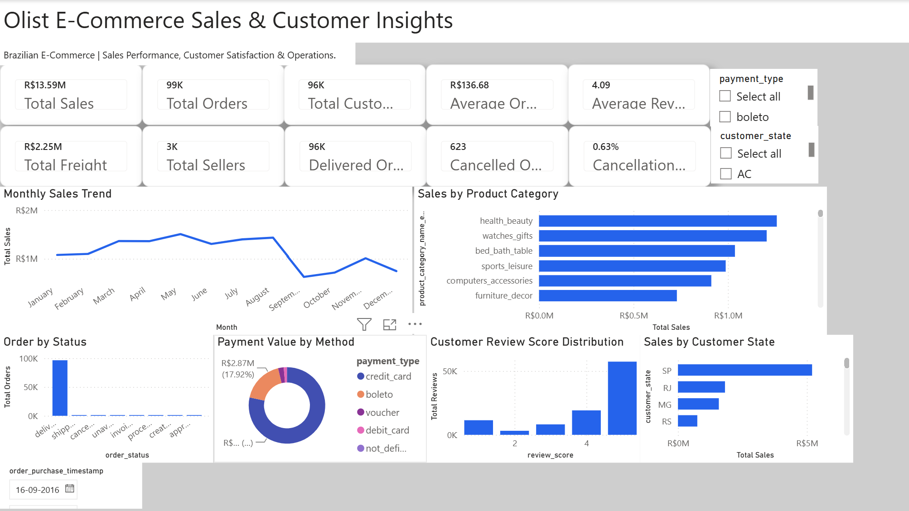
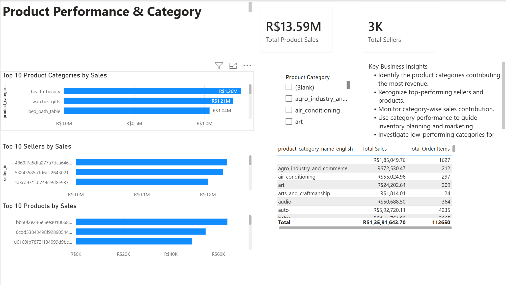
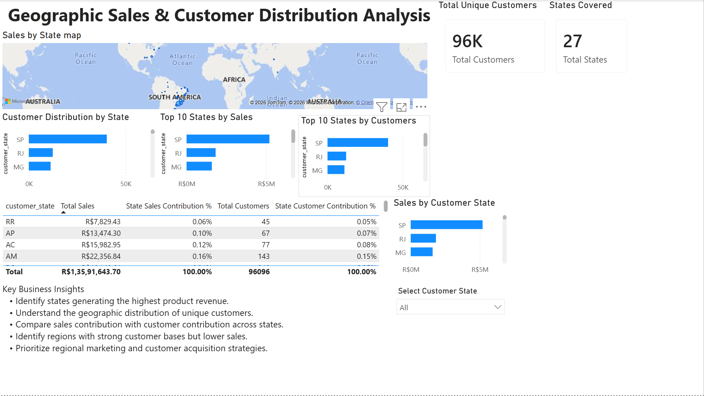
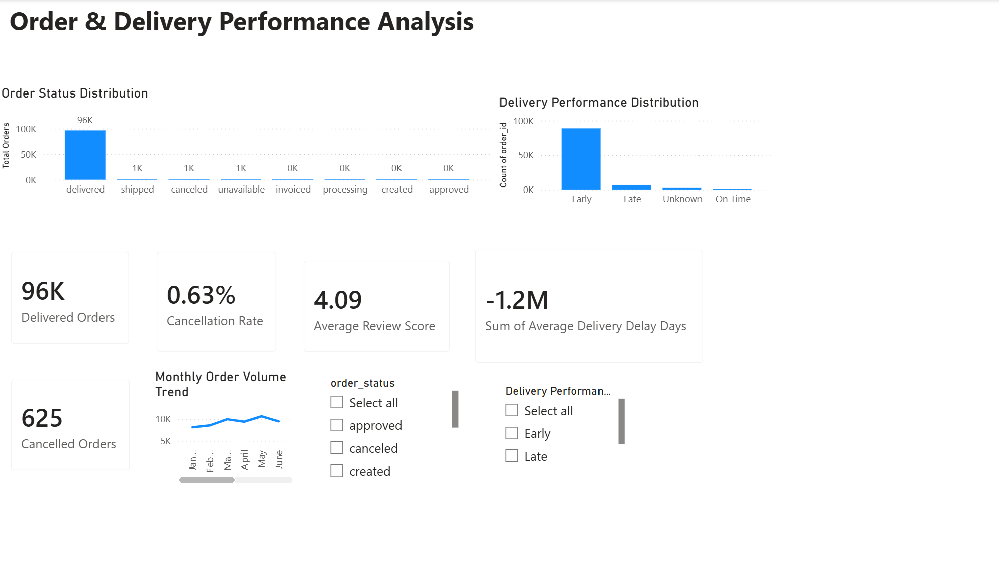
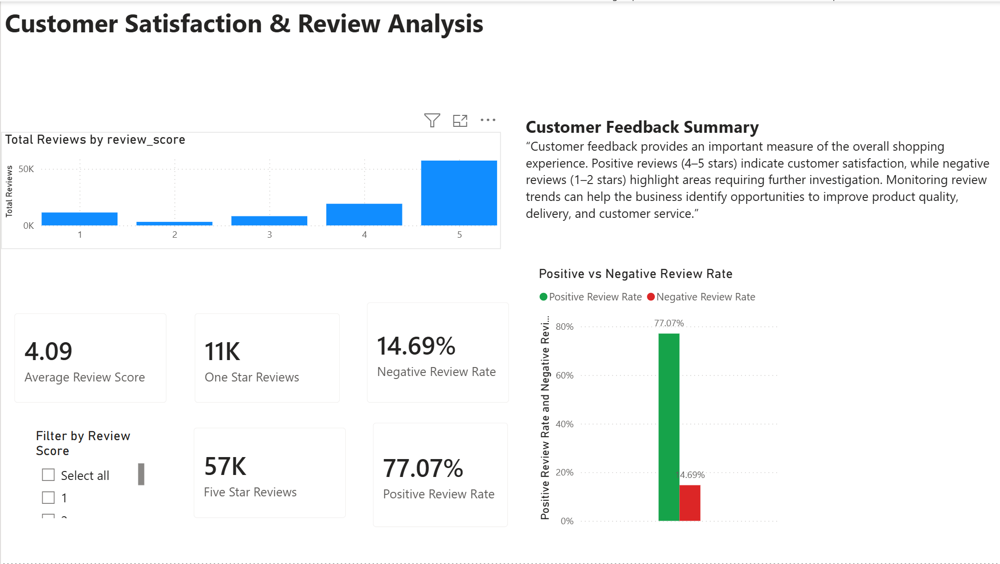
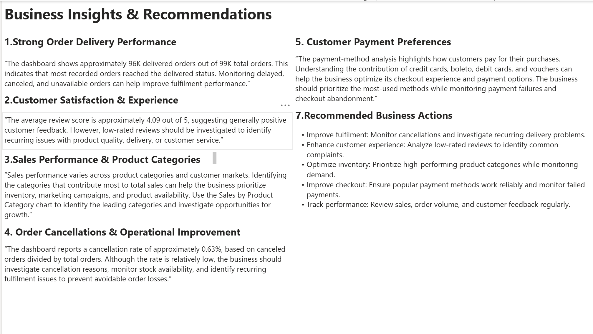
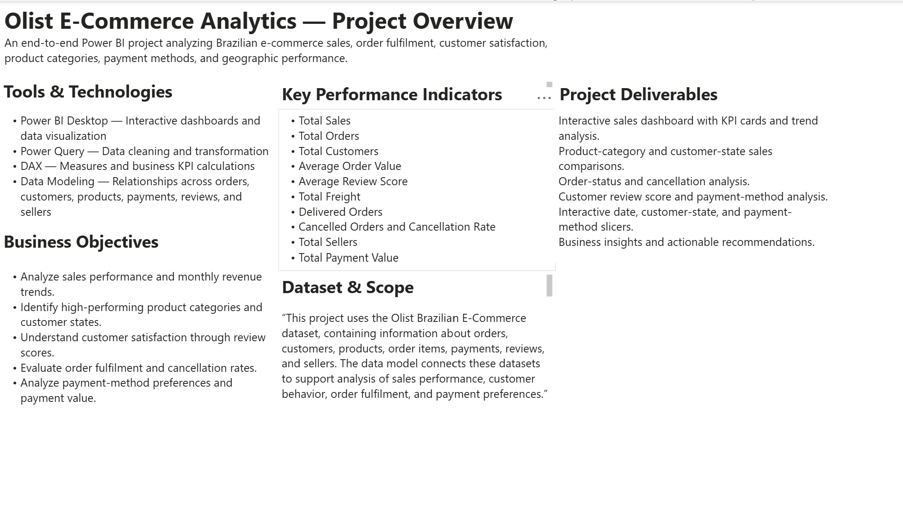

# Olist Brazilian E-Commerce Analytics Dashboard

An interactive **Power BI** project exploring sales performance, customer satisfaction, order fulfilment, product categories, sellers, and geographic distribution for the Olist Brazilian E-Commerce dataset.

## Dashboard Preview

### 1. Sales & Customer Insights

### 2. Product Performance

### 3. Geographic Sales Analysis

### 4. Order & Delivery Analysis

### 5. Customer Insights

### 6. Business Insights & Recommendations

### 7. Project Overview

## Download the Power BI Report

**[Download Olist_Ecommerce_Sales_Dashboard.pbix](https://github.com/ARNOLDJOSHUA2000/olist-powerbi-dashboard/raw/refs/heads/main/Olist_Ecommerce_Sales_Dashboard.pbix)**

Download the file and open it with **Power BI Desktop** to explore the report interactively.

## Project Scope

The report contains seven pages:

1. **Sales & Customer Insights** — overall sales, orders, customer metrics, trends, product categories, payment methods, and customer reviews.
2. **Business Insights & Recommendations** — business findings and suggested actions based on the analysis.
3. **Project Overview** — project objectives, tools, dataset scope, KPIs, and deliverables.
4. **Order & Delivery Analysis** — order status, monthly order volume, delivery timing, and cancellation metrics.
5. **Customer Insights** — review-score distribution, positive and negative feedback rates, and customer feedback observations.
6. **Product Performance** — category revenue, top products, seller performance, and category contribution.
7. **Geographic Sales Analysis** — sales and customer distribution across Brazilian states.

## Key Metrics

- Total Sales
- Total Orders
- Total Unique Customers
- Average Order Value
- Average Review Score
- Delivered and Cancelled Orders
- Cancellation Rate
- Average Delivery Delay
- Product Category Sales Contribution
- State Sales and Customer Contribution

> **Metric definition:** Total Sales is calculated from item prices in the order-items data and excludes freight. Average Order Value uses Total Sales divided by distinct orders.

## Tools & Skills

**Tools:** Power BI Desktop, Power Query, DAX

**Skills demonstrated:**
- Data cleaning and transformation
- Data modeling and relationship design
- DAX measures and calculated columns
- Interactive report and dashboard development
- KPI design and data visualization
- Exploratory business analysis and recommendations

## Dataset

**Olist Brazilian E-Commerce Public Dataset.**

The analysis uses the dataset's order, order-item, customer, product, payment, review, seller, and product-category information.

## Repository Contents

- `Olist_Ecommerce_Sales_Dashboard.pbix` — interactive Power BI report
- `README.md` — project documentation and dashboard previews
- Seven PNG screenshots — previews of the report pages
